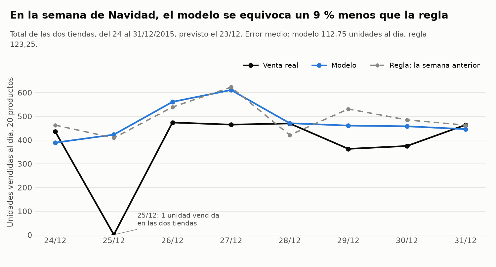
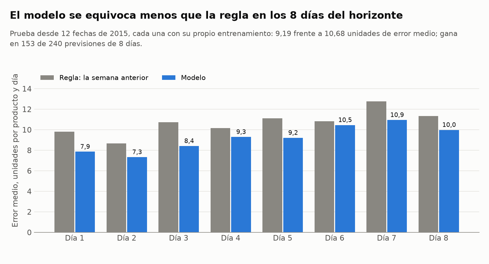
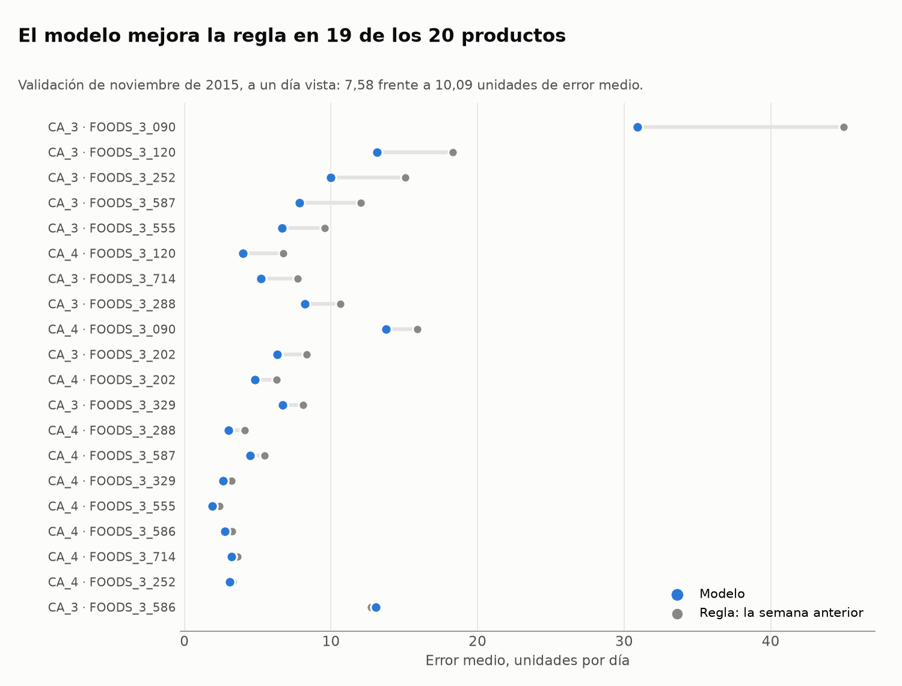

[](https://github.com/jleonceo/store-sales-forecasting-ml/actions/workflows/ci.yml)
[](https://github.com/jleonceo/store-sales-forecasting-ml/actions/workflows/produccion.yml)

Versión en español: [README.md](README.md)

# Daily sales forecasting by store and product

Every morning, a large grocery retailer has to decide how much to buy, where to store it and what to ship to each store. All of that depends on knowing how much will be sold. This project forecasts it for every product and store, 8 days ahead, and runs every day: it adds the previous day's sales and updates the forecast.

A better forecast means less stock sitting in the warehouse, less money tied up in inventory and fewer customers facing an empty shelf.

## Results

In the final test, with December 2015 set aside from the start, the model forecasts one day ahead with a **mean error of 5.20 units**, against 9.10 for the usual purchasing rule. It beats the rule in 13 of the 20 series.

| Measure | Model | "Same as last week" rule |
|---|---|---|
| One day ahead, 20 series (final test, 16 December 2015) | **5.20** units | 9.10 units |
| Eight days ahead, both stores combined (final test, 24 to 31 December 2015) | **114.50** units/day | 123.25 units/day |
| Eight days ahead from 12 dates in 2015, per product and day | **9.19** units | 10.68 units |
| One-day-ahead validation (November 2015, 3 folds of 8 days) | **7.58** units | 10.09 units |

The baseline is what a purchasing manager would do without a model: forecast for each day what was sold on the same weekday of the previous week. Every figure is a mean absolute error, in units, measured against that rule.



In Christmas week, for both stores combined, the model's error is 7 % lower than the rule's.



The test from 12 dates repeats the whole process at each one: it trains on sales up to that day and forecasts the following 8. The model beats the rule on all 8 days of the horizon and in 153 of the 240 eight-day forecasts.



In the November validation, one day ahead, the model improves on the rule in 19 of the 20 series.

The chart titles and labels are in Spanish; the model is shown in blue, the rule in grey and actual sales in black.

## How it is built

- **Data:** three years of daily sales (2013 to 2015) for 10 food products in 2 stores, 20 series in total, with calendar, events and weekly prices. The data is public, from the M5 competition on Kaggle (Walmart): [M5 Forecasting - Accuracy](https://www.kaggle.com/competitions/m5-forecasting-accuracy).
- **Model:** one machine learning model per store and product (HistGradientBoosting, from scikit-learn). The features come from the series' own history: sales on previous days, rolling statistics, calendar and events, price and flags for runs of days without sales.
- **How it is measured:** validation respects the order of time and hyperparameters were searched systematically. December 2015 was held out until the final test.
- **Tests:** every code change runs its automated tests.

## The four challenges of a real forecast

| Challenge | What the project does |
|---|---|
| Several days in a row | Recursive 8-day forecast: each forecast day feeds the next one. |
| Hierarchy | Product, store and total always add up, because they are summed bottom-up. |
| Many series | One model per product and store. The code is the same for any number of series; it has been tested with 20. |
| Days without sales | They are identified and separated: 1,745 single days and 1,259 days with the product out of the store, with dedicated features for stock-out runs. |

## Production simulation

The project includes the batch process that would run every morning. It checks the incoming data, forecasts the next 8 days with sales known up to the previous day, and scores each forecast once actual sales exist. Retraining produces a candidate model, which replaces the one in use only if it does not validate worse, and the previous model can be restored with one command.

A GitHub Actions workflow runs that process over the 31 mornings of December 2015, one after another. December was already used in the final test, so this simulation shows that the process works day by day and does not add a new test of the model.

To see the deployment evidence:

- The [Actions](https://github.com/jleonceo/store-sales-forecasting-ml/actions) tab keeps every run of the `produccion` workflow, with its date, the log of the 31 mornings as the run summary and the outputs as a downloadable artifact. The first one, from 11 November 2026, is [here](https://github.com/jleonceo/store-sales-forecasting-ml/actions/runs/43074677107).
- [`informes/despliegue.json`](informes/despliegue.json) records the latest run: the 31 mornings expected and completed, the model in use and the check that the morning of 24 December reproduces the final test figures.
- [`produccion/salidas/`](produccion/salidas/) holds the forecast and the evaluation of each morning, so they can be read without downloading anything.

## How to reproduce it

Python 3.13 is required. Library versions are pinned in `requirements.txt`.

```bash
pip install -r requirements.txt
python ejecutar_todo.py
```

`ejecutar_todo.py` starts from the two databases in `datos/` and rebuilds everything: unit tests, retraining, the December simulation, results and charts. At the end it checks that the figures on this page match the ones just produced. `python ejecutar_todo.py --backtest` also repeats the test from 12 dates, which takes between one and two hours.

To launch the production workflow on GitHub: **Actions** tab, **produccion** workflow, **Run workflow** button. The test workflow (`ci.yml`) runs on every change.

## Documentation

The technical documents are written in Spanish.

- [Data and quality](docs/01_datos_y_calidad.md): what the data contains and how each issue was handled.
- [Features](docs/02_variables.md): what the model sees for each day and why no feature looks into the future.
- [Model and validation](docs/03_modelo_y_validacion.md): the algorithm, the search and the three measurements.
- [Evaluation](docs/04_evaluacion.md): results by horizon, by series and by level.
- [Experiment](docs/05_experimento.md): the alternatives measured before fixing the model.
- [Production](docs/06_produccion.md): the daily process, retraining, alerts and rollback.
- [Model card](docs/ficha_del_modelo.md): for whoever is going to use the model, with its limits.
- [Input contract](produccion/contrato_entrada.md): what each day's file must contain.

## Limits and next step

The final test is a single month: one day at one day ahead and one week at 8 days ahead. In that week, product by product, the model ties with the rule (10.01 against 10.05); the advantage appears when the stores are added up and in the test from 12 dates. The code has been tested with 20 series.

Beating the rule product by product in weeks like Christmas requires inventory data: knowing whether a day without sales happened because nobody bought or because the shelf was empty.

## License

The code is released under the MIT license ([LICENSE](LICENSE)). The data belongs to its original source: [M5 Forecasting - Accuracy](https://www.kaggle.com/competitions/m5-forecasting-accuracy).
