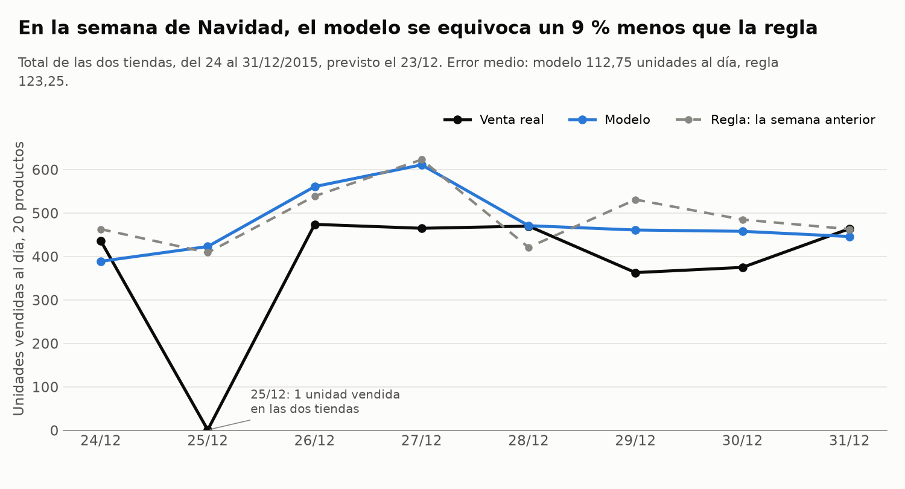
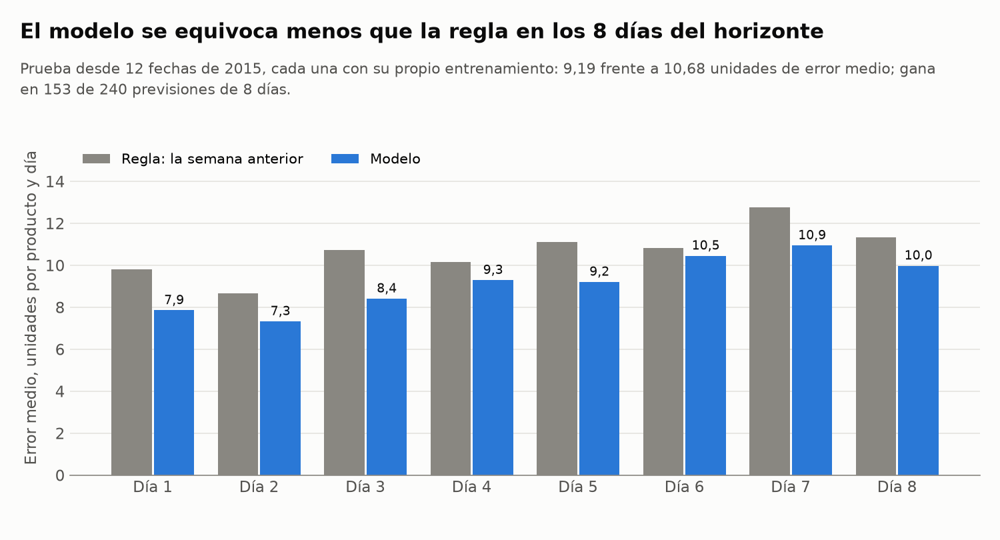
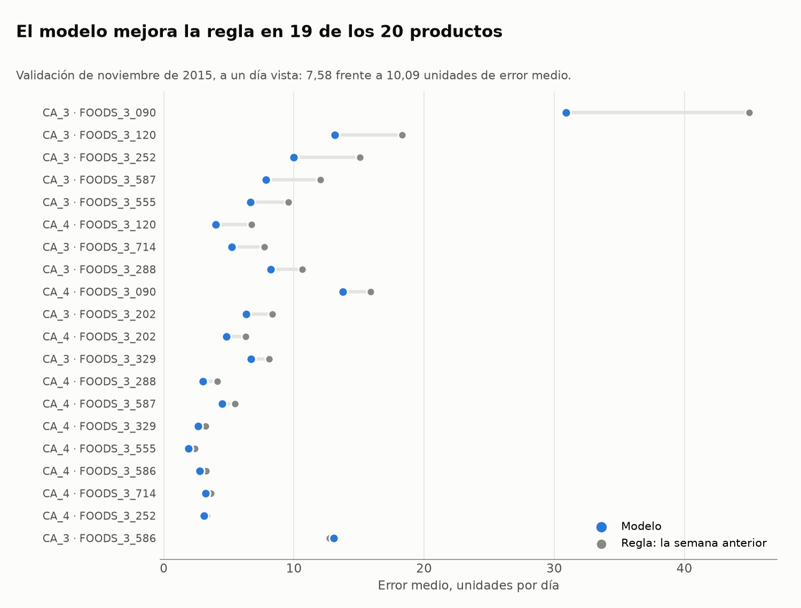

[](https://github.com/jleonceo/store-sales-forecasting-ml/actions/workflows/ci.yml)
[](https://github.com/jleonceo/store-sales-forecasting-ml/actions/workflows/produccion.yml)

English version: [README.en.md](README.en.md)

# Previsión diaria de ventas por tienda y producto

Cada mañana, un gran distribuidor de alimentación tiene que decidir cuánto comprar, dónde guardarlo y qué enviar a cada tienda. Todo eso depende de saber cuánto se va a vender. Este proyecto lo prevé para cada producto y tienda con 8 días de antelación, y se ejecuta cada día: suma las ventas del día anterior y recalcula la previsión.

Con mejor previsión hay menos almacén lleno, menos dinero parado en mercancía y menos estantes vacíos.

## En cifras

En diciembre de 2015, un mes reservado desde el principio y nunca usado para entrenar, el modelo se equivoca de media en **7,45 unidades** al prever el día siguiente, mañana a mañana durante las 31 del mes. Repetir lo vendido el mismo día de la semana anterior, que es lo que haría un responsable de compras sin un modelo, se equivoca en 10,43. El modelo lo hace mejor en 20 de las 31 mañanas.

| Medida | Modelo | Repetir la semana anterior |
|---|---|---|
| Día siguiente, las 31 mañanas de diciembre de 2015 | **7,45** uds. | 10,43 uds. |
| Ocho días por delante, repetido desde 12 fechas de 2015, por producto y día | **8,87** uds. | 10,68 uds. |
| Ocho días por delante, total de las dos tiendas (24 al 31/12/2015) | **112,75** uds./día | 123,25 uds./día |
| Validación del día siguiente (noviembre de 2015, 3 tramos de 8 días) | **7,46** uds. | 10,09 uds. |

Todas las cifras son error absoluto medio en unidades: cuánto se desvía de media la previsión de la venta real.



En la semana de Navidad, con el total de las dos tiendas, el error del modelo es un 9 % menor que el de repetir la semana anterior.



En cada una de las 12 fechas de 2015 se entrena el modelo solo con lo vendido hasta ese día y se prevén los 8 días siguientes. El error baja un 17 % frente a la semana anterior, y el modelo se equivoca menos en cada uno de los 8 días y en 160 de las 240 previsiones. También gana a dos reglas más difíciles de batir: la media de los 7 últimos días (9,67) y la media del mismo día en las 4 semanas anteriores (10,10).

Antes de fijar el modelo, esa misma prueba se repitió con nueve configuraciones: valores por defecto, búsqueda de hiperparámetros, una competición entre seis algoritmos y dos correcciones de los datos. En 2015 la búsqueda de hiperparámetros por serie fue el cambio que más bajó el error; en diciembre esa ventaja no se confirmó. Las cifras están en el [documento del experimento](docs/05_experimento.md) y los resultados completos, en [`informes/experimento.json`](informes/experimento.json).



En la validación de noviembre, prediciendo el día siguiente, el modelo se equivoca menos en 20 de las 20 combinaciones.

## Cómo funciona

- Datos: tres años de ventas diarias (2013 a 2015) de 10 productos de alimentación en 2 tiendas, 20 series en total, con calendario, eventos y precios semanales. Son datos públicos de la competición M5 de Kaggle (Walmart): [M5 Forecasting - Accuracy](https://www.kaggle.com/competitions/m5-forecasting-accuracy).
- Modelo: un modelo de aprendizaje automático para cada producto y tienda (HistGradientBoosting, de scikit-learn). Las variables salen del propio historial: ventas de días anteriores, medias móviles, calendario y eventos, precio e indicadores de días seguidos sin ventas.
- **Cómo se mide:** la validación respeta el orden del tiempo y los hiperparámetros se eligieron probando combinaciones de forma ordenada. Diciembre de 2015 quedó apartado hasta la prueba final.
- **Pruebas:** cada cambio del código pasa sus pruebas automáticas.

## Cuatro dificultades de una previsión real

| Dificultad | Qué hace el proyecto |
|---|---|
| Prever varios días | Prevé 8 días seguidos: la previsión de cada día se usa para calcular el siguiente. |
| Totales que cuadran | Los totales por tienda y el general se obtienen sumando las previsiones de cada producto, así que cuadran siempre. |
| Muchos productos y tiendas | Un modelo por producto y tienda. El código es el mismo para cualquier número de series; se ha probado con 20. |
| Días sin ventas | Se detectan y se tratan aparte: 1.745 días sueltos sin ventas y 1.259 días en que el producto no estaba a la venta en la tienda, con variables propias para las rachas sin ventas. |

## Simulación de producción

El proyecto incluye el proceso por lotes que se ejecutaría cada mañana. Revisa los datos recibidos, prevé los 8 días siguientes con las ventas hasta el día anterior y, cuando se conoce la venta real, mide cuánto se ha equivocado. Al reentrenar se prepara un modelo nuevo, que solo sustituye al actual si, frente a la regla, valida al menos igual de bien, y el anterior se puede recuperar con un comando.

Un flujo de GitHub Actions ejecuta ese proceso para las 31 mañanas de diciembre de 2015, una tras otra. Diciembre ya se usó en la prueba final, así que la simulación comprueba que el proceso funciona día a día; no es una prueba nueva del modelo.

Para comprobar el despliegue:

- El historial de la pestaña [Actions](https://github.com/jleonceo/store-sales-forecasting-ml/actions) guarda cada ejecución del flujo `produccion`, con su fecha, el registro de las 31 mañanas y los resultados para descargar. La primera, del 11/11/2026, está [aquí](https://github.com/jleonceo/store-sales-forecasting-ml/actions/runs/43074677107).
- [`informes/despliegue.json`](informes/despliegue.json) resume la última ejecución del proceso en este repositorio: las 31 mañanas previstas y las hechas, el modelo en uso y la comprobación de que el 24/12 da las cifras esperadas.
- [`produccion/salidas/`](produccion/salidas/) contiene la previsión y la evaluación de cada mañana, para verlas sin descargar nada.

## Cómo reproducirlo

Hace falta Python 3.13. Las versiones de las librerías están fijadas en `requirements.txt`.

```bash
pip install -r requirements.txt
python ejecutar_todo.py
```

`ejecutar_todo.py` parte de los dos ficheros de `datos/` y repite todo el proceso: pruebas unitarias, reentreno, simulación de diciembre, resultados y gráficos. Al final comprueba que las cifras de este README coinciden con las recién calculadas. Con `python ejecutar_todo.py --backtest` repite también la prueba desde 12 fechas, que tarda entre una y dos horas.

Para ejecutar la producción en GitHub: pestaña **Actions**, flujo **produccion**, botón **Run workflow**. Las pruebas (`ci.yml`) se ejecutan automáticamente con cada cambio.

## Documentación

El proyecto sigue las fases de CRISP-DM, y cada documento corresponde a una:

| Fase | Documento |
|---|---|
| Comprensión del negocio | Esta portada: el problema y la regla con la que se compara |
| Comprensión de los datos | [Datos y calidad](docs/01_datos_y_calidad.md): qué traen los datos y qué se hizo con cada problema |
| Preparación de los datos | [Variables](docs/02_variables.md): qué datos usa el modelo de cada día y por qué ninguno incluye información posterior |
| Modelado | [Modelo y validación](docs/03_modelo_y_validacion.md) y [Experimento](docs/05_experimento.md): el algoritmo, cómo se eligieron sus ajustes y las alternativas medidas |
| Evaluación | [Evaluación](docs/04_evaluacion.md): los resultados por día previsto, por producto y tienda y por nivel de agrupación |
| Despliegue | [Producción](docs/06_produccion.md), [Ficha del modelo](docs/ficha_del_modelo.md) y [Contrato de entrada](produccion/contrato_entrada.md): el proceso diario, el reentreno, la vuelta atrás y lo que necesita y entrega |

Una revisión externa del código encontró errores en la primera versión; la evaluación llevó de vuelta a la preparación de los datos y al modelado, como prevé CRISP-DM. Lo que cambió está en [CHANGELOG.md](CHANGELOG.md).

## Límites y siguiente paso

La prueba final cubre un solo mes. En la semana de Navidad, producto a producto, el modelo queda algo por delante de la regla (9,61 frente a 10,05), pero la diferencia cabe en el azar; la ventaja clara se ve al sumar las dos tiendas, a un día vista y en la prueba desde 12 fechas. El modelo tiende a prever algo de más, y donde más se equivoca es en los días sin venta. El código se ha probado con 20 series.

Para superar a la regla también producto a producto en semanas como la de Navidad haría falta el dato de inventario: saber si un día sin ventas fue porque nadie compró o porque no quedaba producto en el estante.

## Licencia

El código se publica con licencia MIT ([LICENSE](LICENSE)). Los datos son de su fuente original: [M5 Forecasting - Accuracy](https://www.kaggle.com/competitions/m5-forecasting-accuracy).
